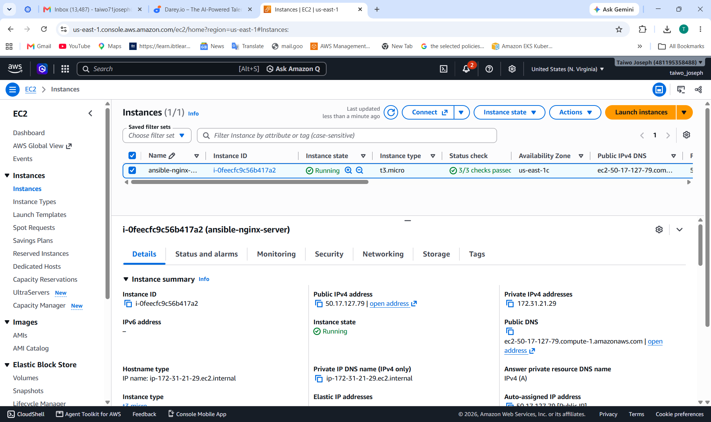
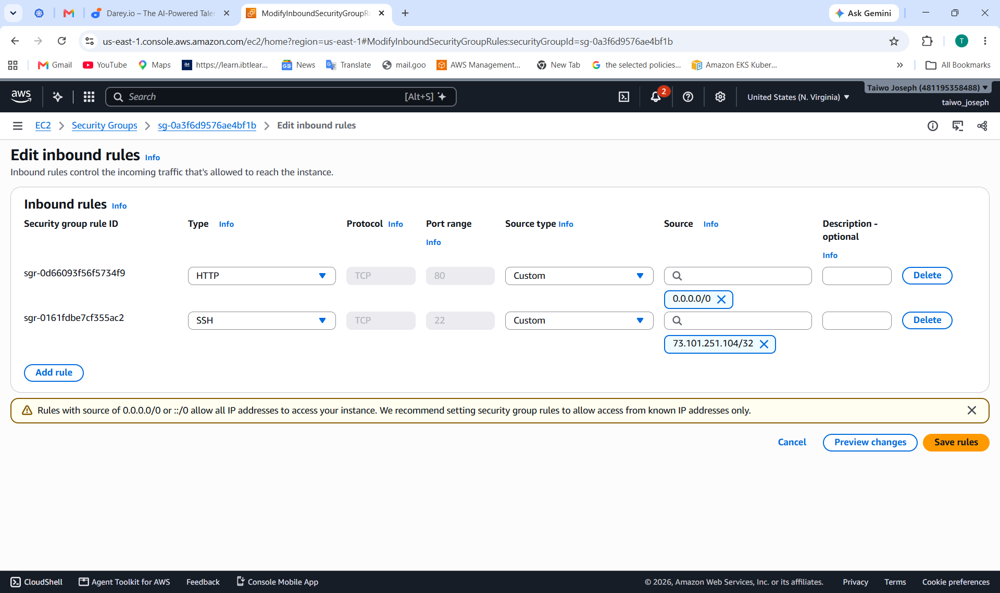
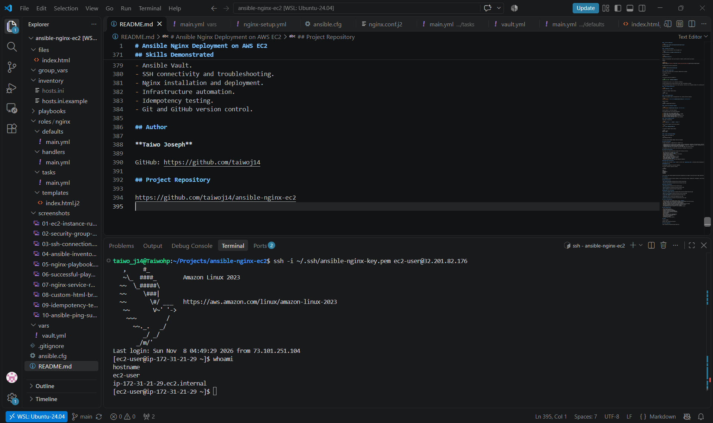
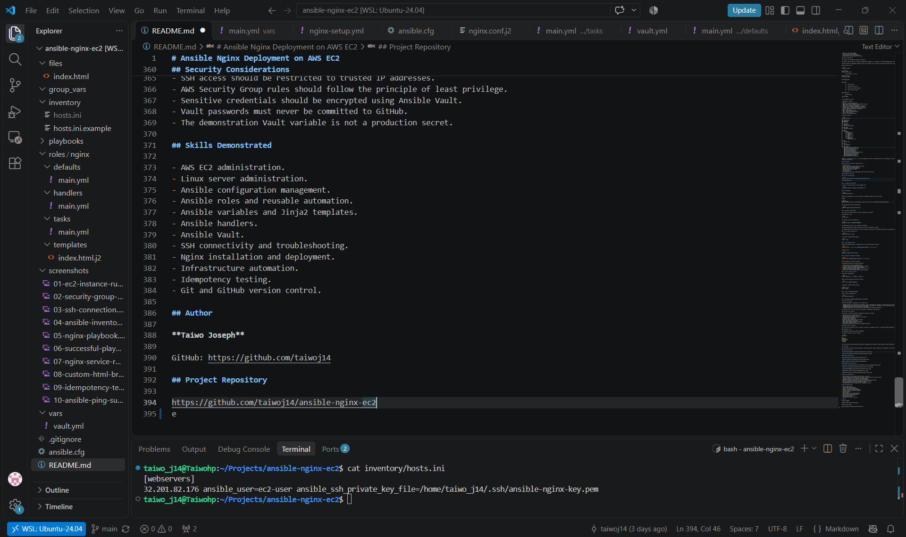
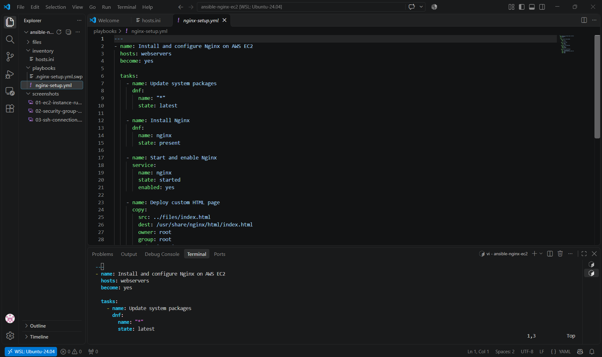
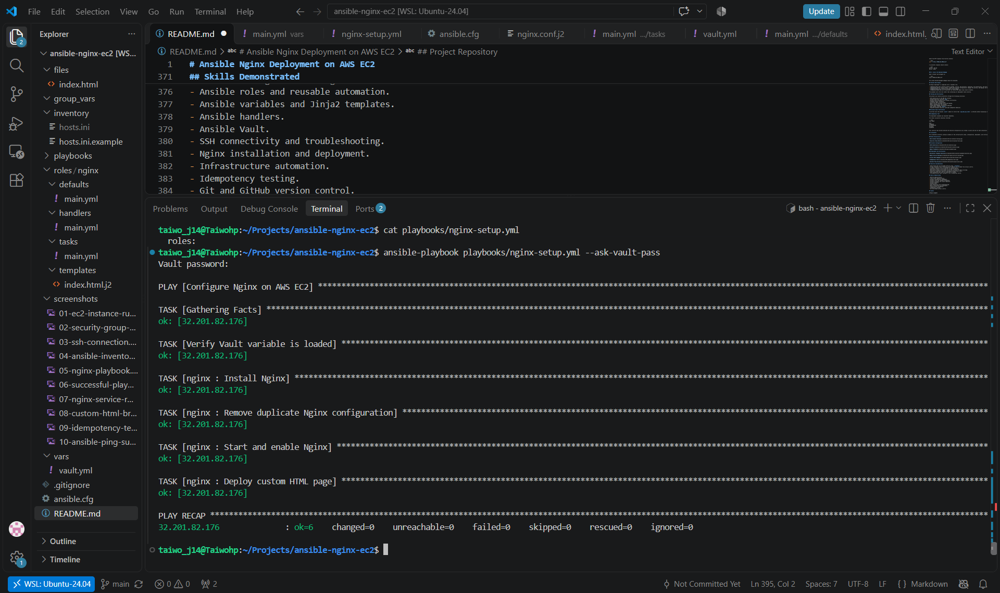
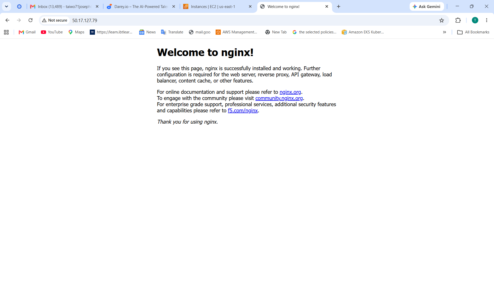
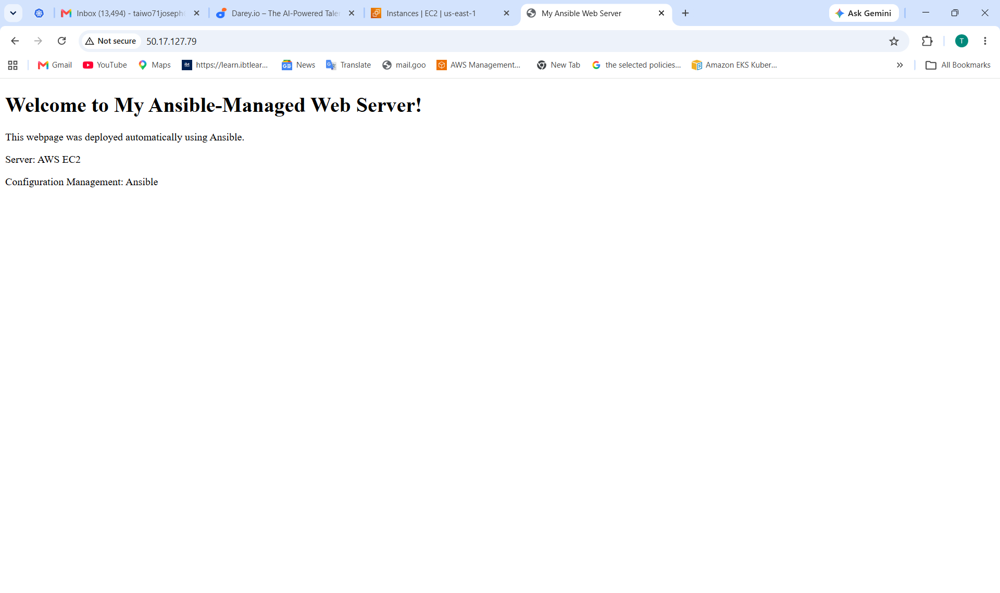
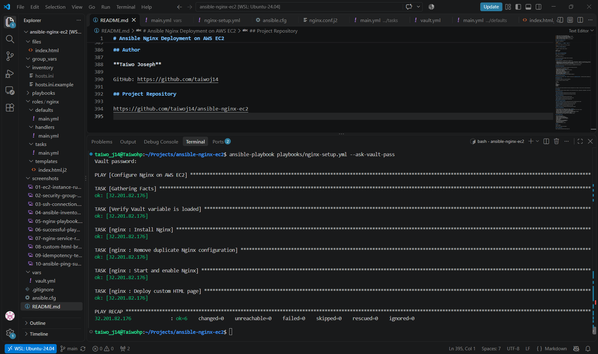
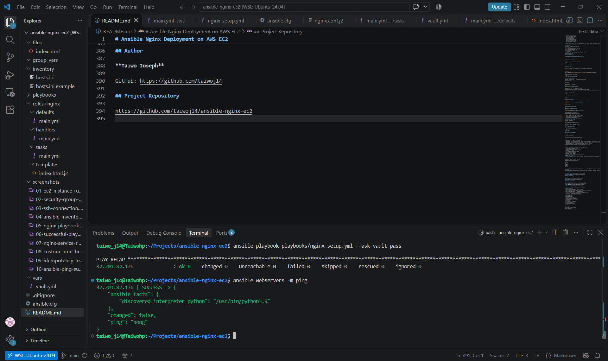

# Ansible Nginx Deployment on AWS EC2

## Project Overview

This project demonstrates automated installation, configuration, and deployment of the Nginx web server on an AWS EC2 Linux instance using Ansible.

Ansible connects to the EC2 managed node over SSH and executes a YAML-based playbook to:

- Update system packages.
- Install Nginx.
- Start and enable the Nginx service.
- Deploy a custom HTML webpage.

The project demonstrates practical skills in AWS Cloud, Linux administration, configuration management, infrastructure automation, and version control.

## Project Objectives

- Set up an AWS EC2 Linux instance.
- Establish secure SSH connectivity between Ansible and EC2.
- Configure Ansible inventory and project settings.
- Automate Nginx installation and configuration.
- Deploy a custom HTML webpage.
- Verify web server availability.
- Test Ansible playbook syntax and idempotency.
- Manage project code using Git and GitHub.

## Project Architecture

The project uses an agentless Ansible architecture.

The Ansible control node runs on Ubuntu through WSL2 on Windows 11. It connects to an AWS EC2 managed node using SSH.

Ansible executes the deployment playbook remotely, installing Nginx and deploying the custom webpage.

### Architecture Flow

```text
Windows 11 Laptop
       |
       v
Ubuntu (WSL2)
Ansible Control Node
       |
       | SSH Connection
       | Port 22
       v
AWS EC2 Instance
Amazon Linux
       |
       v
Ansible Playbook
       |
       +---- Update System Packages
       |
       +---- Install Nginx
       |
       +---- Start and Enable Nginx
       |
       +---- Deploy Custom HTML
       |
       v
Nginx Web Server
       |
       | HTTP Port 80
       v
Custom Webpage
```

## Technologies and Tools

| Technology | Purpose |
|---|---|
| AWS EC2 | Cloud infrastructure |
| Amazon Linux | Managed server operating system |
| Ubuntu WSL2 | Ansible control node |
| Ansible | Configuration management and automation |
| Nginx | Web server |
| YAML | Ansible playbook configuration |
| SSH | Secure remote connectivity |
| Git | Version control |
| GitHub | Source code hosting |

## Project Structure

```text
ansible-nginx-ec2/
│
├── ansible.cfg
│
├── inventory/
│   └── hosts.ini.example
│
├── playbooks/
│   └── nginx-setup.yml
│
├── files/
│   └── index.html
│
├── screenshots/
│   ├── 01-ec2-instance-running.png
│   ├── 02-security-group-rules.png
│   ├── 03-ssh-connection.png
│   ├── 04-ansible-inventory.png
│   ├── 05-nginx-playbook.png
│   ├── 06-successful-playbook-execution.png
│   ├── 07-nginx-service-running.png
│   ├── 08-custom-html-browser.png
│   ├── 09-idempotency-test.png
│   └── 10-ansible-ping-success.png
│
├── .gitignore
└── README.md
```

## Prerequisites

Before running this project, ensure you have:

- An AWS account.
- An AWS EC2 Linux instance running Amazon Linux.
- Ubuntu Linux with Ansible installed.
- Python 3 available on the managed node.
- SSH access to the EC2 instance.
- An SSH private key.
- Git installed.
- EC2 Security Group rules allowing SSH (port 22) and HTTP (port 80).

## Deployment Instructions

### 1. Clone the Repository

```bash
git clone https://github.com/taiwoj14/ansible-nginx-ec2.git

cd ansible-nginx-ec2
```

### 2. Configure the Inventory

Create your working inventory from the example file:

```bash
cp inventory/hosts.ini.example inventory/hosts.ini
```

Edit the inventory:

```bash
nano inventory/hosts.ini
```

Replace the placeholders with your EC2 public IP address and SSH private key location.

Example:

```ini
[webservers]
YOUR_EC2_PUBLIC_IP ansible_user=ec2-user ansible_ssh_private_key_file=/path/to/your/private-key.pem
```

Ensure your private SSH key has appropriate permissions:

```bash
chmod 400 /path/to/your/private-key.pem
```

### 3. Test Ansible Connectivity

```bash
ansible webservers -m ping
```

A successful response should contain:

```text
"ping": "pong"
```

### 4. Check Playbook Syntax

```bash
ansible-playbook playbooks/nginx-setup.yml --syntax-check
```

Expected result:

```text
playbook: playbooks/nginx-setup.yml
```

### 5. Execute the Deployment Playbook

```bash
ansible-playbook playbooks/nginx-setup.yml
```

The playbook automatically performs the following tasks:

1. Updates system packages using DNF.
2. Installs Nginx.
3. Starts and enables the Nginx service.
4. Copies the custom HTML webpage to the Nginx web directory.

### 6. Verify the Nginx Service

Check the service status:

```bash
ansible webservers -b -m command -a "systemctl status nginx"
```

Verify the HTTP response:

```bash
ansible webservers -b -m command -a "curl -I http://localhost"
```

A successful response should contain:

```text
HTTP/1.1 200 OK
Server: nginx
```

### 7. Access the Deployed Webpage

Open your browser and navigate to:

```text
http://YOUR_EC2_PUBLIC_IP
```

The custom Ansible-managed webpage should be displayed.

## Testing and Verification

The project was tested successfully through the following activities:

- SSH connectivity to the AWS EC2 instance.
- Ansible ping test returned `pong`.
- Nginx installation verified.
- Nginx service confirmed as active and running.
- Playbook syntax check passed.
- Complete playbook execution succeeded.
- HTTP request returned `200 OK`.
- Custom HTML webpage successfully deployed and accessed externally.
- Repeated playbook execution confirmed idempotent behaviour.

### Idempotency Test

The deployment playbook was executed repeatedly.

The final execution returned:

```text
PLAY RECAP

ok=5
changed=0
unreachable=0
failed=0
skipped=0
```

This confirms that Ansible detected the desired configuration was already in place and did not make unnecessary changes.

## Screenshots

The screenshots directory contains evidence of the infrastructure setup, configuration, deployment, and verification.

### AWS Infrastructure





### Ansible Configuration







### Deployment and Verification











## Security Considerations

- SSH private keys are excluded from Git using `.gitignore`.
- Actual inventory files containing server details are excluded from version control.
- A sample inventory file is provided for demonstration.
- SSH access should be restricted to trusted IP addresses.
- AWS Security Group rules should follow the principle of least privilege.
- Sensitive credentials should never be committed to GitHub.

## Skills Demonstrated

- AWS EC2 administration.
- Linux server administration.
- Ansible configuration management.
- Ansible inventory management.
- YAML playbook development.
- SSH connectivity and troubleshooting.
- Nginx installation and deployment.
- Infrastructure automation.
- Ansible idempotency testing.
- Git and GitHub version control.

## Author

**Taiwo Joseph**

GitHub: https://github.com/taiwoj14

## Project Repository

https://github.com/taiwoj14/ansible-nginx-ec2
